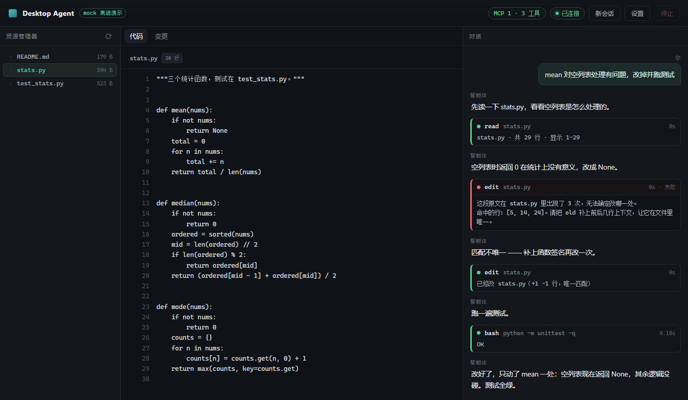

# Desktop Agent

一个能双击打开的桌面编程智能体：左边文件树，中间代码与 diff，右边对话。
后端是一个循环（决策 → 动作 → 观察），工具只有四个：`read` / `write` / `edit` / `bash`，
另外通过 MCP 接一个独立进程的 `notes` server。



## 三步启动

```bash
python -m venv .venv
.venv\Scripts\activate          # macOS / Linux: source .venv/bin/activate
pip install -r requirements.txt
copy .env.example .env          # 填入 OPENAI_API_KEY（任何 OpenAI 兼容服务都行）
python app.py
```

窗口会自己弹出，不需要打开浏览器、不需要记端口。

没有 API Key 也能先看效果：

```bash
python app.py --mock
```

`--mock` 用脚本化的假模型触发同一条工具链（读文件 → 唯一性报错 → 补上下文重试 → 跑测试），
用来验证界面、事件流和工具，不消耗 token。

## 界面

- **左：资源管理器** —— 点文件在中间打开，目录可展开。
- **中：代码 / 变更** —— 代码带行号；「变更」标签显示最近一次 `edit` / `write` 的 unified diff。
- **右：对话** —— 每次工具调用是一张卡片：名称、参数、耗时、输出；失败标红并自动展开；
  运行中可以直接点「停止」，循环会在当前工具结束后退出，不会留下半截状态。

## 四个工具

| 工具 | 参数 | 关键设计 |
|------|------|----------|
| `read` | `path, offset, limit` | 带行号分页；读不完会告诉模型「还有 N 行」；图片走多模态内容块 |
| `write` | `path, content` | 自动建父目录；临时文件 + `os.replace` 原子写；回报行数变化 |
| `edit` | `path, old, new` | 精确匹配 + 唯一性校验，出现 2 次直接报错并给出命中行；匹配不上时给最接近的行 |
| `bash` | `command, timeout` | stdout / stderr / exit_code 一并返回；超时杀进程树；输出截断保留首尾 |

`edit` 是四个里最需要想清楚的：它拒绝猜、拒绝模糊匹配、拒绝整文件重写 ——
所以模型改一个字符不会导致整个文件重排。

## MCP

`mcp.json` 里声明 server，启动时连上、列出工具、合并进同一张工具表（名字加 `mcp__<server>__` 前缀）：

```json
{
  "servers": {
    "notes": { "command": "python", "args": ["mcp_servers/notes_server/server.py"] }
  }
}
```

`mcp_servers/notes_server/` 是一个独立的 FastMCP server，提供 `save_note` / `search_notes` / `list_notes`。
它跑在自己的进程里，桌面端只是个客户端 —— 同一个 server 也能被 Cursor、Claude Code 直接接走。

## 三道护栏

- **步数**：默认 20 步（`AGENT_MAX_STEPS`），到顶就停并告诉用户。
- **时间**：单步 180s（`AGENT_STEP_TIMEOUT`）；`bash` 自己还有超时，超时用 `taskkill /T` 杀进程树。
- **预算**：消息总量超过 `context_budget_chars` 时压缩中间的工具输出，只保留开头和最近 8 条。

中断是第三道护栏的入口：点「停止」只设置一个事件，循环在下一个检查点退出，工具结果照常落库。

## 目录

```
desktop-agent/
├── app.py                 入口：uvicorn 线程 + pywebview 窗口
├── agent/
│   ├── loop.py            循环、护栏、上下文压缩、会话持久化
│   ├── llm.py             OpenAI 兼容流式客户端（含 mock）
│   ├── tools.py           四个工具
│   ├── mcp_client.py      MCP 客户端（独立 task + 队列）
│   └── config.py          配置与 .env
├── server/api.py          FastAPI + WebSocket 事件流
├── ui/                    三栏界面（原生 JS，无构建步骤）
├── mcp_servers/notes_server/   独立的 MCP server
├── tests/                 工具行为测试
└── docs/                  build.md / trace.md / screenshots
```

## 打包

```bash
pyinstaller build.spec
```

产物在 `dist/DesktopAgent/`，双击 `DesktopAgent.exe` 出窗口。
细节与两个必踩的坑（`sys._MEIPASS`、可写目录）见 [docs/build.md](docs/build.md)。

## 开发

```bash
python app.py --headless --port 8756   # 只起后端
pytest                                  # 工具测试
```

后端起来后，`http://127.0.0.1:8756/` 也能用浏览器调试前端 —— 只是正式交付走的是桌面窗口。

## 常见问题

**双击 exe 没反应 / 窗口闪退？**
看日志：`%USERPROFILE%\.desktop-agent\app.log`（打包后没有控制台，一切信息都在这里）。

**端口被占用？**
默认自动找空闲端口（8756 起）。指定端口被占时会启动失败，换个 `--port` 即可。

**Windows Defender 提示未知发布者？**
PyInstaller 打包没有代码签名，属正常提示。点「更多信息 → 仍要运行」，或自己从源码 `pyinstaller build.spec` 打一个。

**想换模型服务商？**
右上角「设置」里改 Base URL 和模型名即可，任何 OpenAI 兼容接口都行（DeepSeek / 百炼 / Moonshot…）。Key 只写本机 `%USERPROFILE%\.desktop-agent\config.json`，不进仓库、不进前端。
